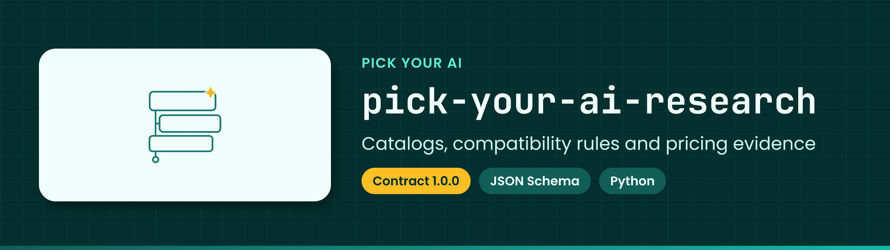

<!-- showcase:banner:start -->
<p align="center">
  
</p>
<!-- showcase:banner:end -->

<!-- showcase:nav:start -->
**Pick Your AI** · [All repositories](https://github.com/Pick-Your-AI) · [Docs](docs/) · [Contributing](CONTRIBUTING.md) · [Security](SECURITY.md)
<!-- showcase:nav:end -->

<div align="center">

# Pick Your AI research

<!-- showcase:badges:start -->


<!-- showcase:badges:end -->

<!-- showcase:tagline:start -->
**Research and shared data contracts for Pick Your AI: component catalogs, compatibility rules, pricing, and evidence for AI stacks.**
<!-- showcase:tagline:end -->

</div>

---

## About

Mobile planning issues now live in `Pick-Your-AI/pick-your-ai-android` and `Pick-Your-AI/pick-your-ai-apple`. See the [migration record](prompts/mobile/MIGRATION.md). Repository creation resolves location only; framework, modules and service placement remain gated. Existing acceptance-record paths are preserved. Historical snapshots below do not override the live migration.

Research for an AI system builder inspired by [PCPartPicker](https://pcpartpicker.com/): choose compatible AI components, compare costs and tradeoffs, and save or share a configuration with evidence behind its recommendations.

[Technical research Project](https://github.com/orgs/Pick-Your-AI/projects/1) · [Market research Project](https://github.com/orgs/Pick-Your-AI/projects/2) · [Issues](https://github.com/Pick-Your-AI/pick-your-ai-research/issues) · [Organization](https://github.com/Pick-Your-AI)

## Notes

### Start here

1. Find your assigned issue in the relevant Project. Read its scope, acceptance criteria, deliverable path, and existing PRs before starting.
2. Follow the [research submission workflow](docs/RESEARCH_WORKFLOW.md) and [research method](docs/RESEARCH_METHOD.md). Use the [research note template](templates/research-note.md) to record findings, sources, dates, conditions, and unknowns.
3. For component data, use the [canonical schemas](contracts/v1/schemas/), [component-kind registry](contracts/v1/schemas/component-registry.json), and [issue-to-kind mapping](docs/CONTRACT_MAPPING.md). All researchers use the same contract **1.0.0**, adopted in [PR #44](https://github.com/Pick-Your-AI/pick-your-ai-research/pull/44).
4. Submit a PR referencing the issue. Use `Refs #n` for partial work and `Closes #n` only when all acceptance criteria and handoffs are satisfied. Follow [contributing conventions](CONTRIBUTING.md) and [governance](docs/governance.md).

Client implementers: use the [pinned consumer handoff](docs/CONSUMER_HANDOFF.md) for immutable artifacts, known baseline limitations and remaining receiving gates.

Keep incomplete findings in notes. Never invent a required value to satisfy a schema. The contract's examples are synthetic; passing validation does not verify vendor claims or establish production readiness. Propose contract changes through [Pick-Your-AI/pick-your-ai-research#40](https://github.com/Pick-Your-AI/pick-your-ai-research/issues/40); see [contract adoption and limitations](contracts/v1/ADOPTION.md).

### Research programs

### Technical components — Project 1

The builder starts with a workload and deployment mode, then covers models, infrastructure, optional retrieval, optional agents, optional training, and operations. Choices can constrain one another in both directions; the [dependency map](docs/DEPENDENCIES.md) records these relationships.

| Workstream | Lead issue assignee |
| --- | --- |
| [T0: Configuration](https://github.com/Pick-Your-AI/pick-your-ai-research/issues/1) | @tynamite |
| [T1: Model Selection](https://github.com/Pick-Your-AI/pick-your-ai-research/issues/4) | @zwright8 |
| [T2: Infrastructure](https://github.com/Pick-Your-AI/pick-your-ai-research/issues/8) | @Mattycodes69 |
| [T3: Knowledge & Retrieval](https://github.com/Pick-Your-AI/pick-your-ai-research/issues/12) (optional) | @zabyxc01 |
| [T4: Agents & Integrations](https://github.com/Pick-Your-AI/pick-your-ai-research/issues/24) (optional) | @CompleteDotTech |
| [T5: Training & Fine-Tuning](https://github.com/Pick-Your-AI/pick-your-ai-research/issues/29) (optional) | @appletechie |
| [T6: Deployment & Operations](https://github.com/Pick-Your-AI/pick-your-ai-research/issues/34) | @PUSHINGSQUARES |

Shared decisions are tracked in [Pick-Your-AI/pick-your-ai-research#40: schemas and compatibility](https://github.com/Pick-Your-AI/pick-your-ai-research/issues/40), [Pick-Your-AI/pick-your-ai-research#41: catalog sources and freshness](https://github.com/Pick-Your-AI/pick-your-ai-research/issues/41), and [Pick-Your-AI/pick-your-ai-research#42: saved/shared builds](https://github.com/Pick-Your-AI/pick-your-ai-research/issues/42).

### Market and customer research — Project 2

[Program Pick-Your-AI/pick-your-ai-research#47](https://github.com/Pick-Your-AI/pick-your-ai-research/issues/47) coordinates competition, customer demand, monetization, and product scope. Market findings use the issue's evidence format; they only become component catalog records when that format applies.

Read the [market research guide](docs/market-research/README.md), [competitive landscape](docs/market-research/competitive-landscape.md), and [research synthesis](research/market/synthesis.md). These records distinguish reviewed partial research from pending validation and owner decisions.

| Workstream | Lead issue assignee |
| --- | --- |
| [MR-01: Competitive landscape](https://github.com/Pick-Your-AI/pick-your-ai-research/issues/48) | @appletechie |
| [MR-02: Competitive feature matrix](https://github.com/Pick-Your-AI/pick-your-ai-research/issues/49) | @zwright8 |
| [MR-03: Competitor deep dives](https://github.com/Pick-Your-AI/pick-your-ai-research/issues/50) | @appletechie |
| [MR-04: PCPartPicker experience](https://github.com/Pick-Your-AI/pick-your-ai-research/issues/51) | @appletechie |
| [MR-05: Customers and personas](https://github.com/Pick-Your-AI/pick-your-ai-research/issues/52) | @appletechie |
| [MR-06: Market size, demand and trends](https://github.com/Pick-Your-AI/pick-your-ai-research/issues/53) | @appletechie |
| [MR-07: Pricing and monetization](https://github.com/Pick-Your-AI/pick-your-ai-research/issues/54) | @appletechie |
| [MR-08: Data sources and integrations](https://github.com/Pick-Your-AI/pick-your-ai-research/issues/55) | @tynamite |
| [MR-09: Technical feasibility](https://github.com/Pick-Your-AI/pick-your-ai-research/issues/56) | @Mattycodes69 |
| [MR-10: Differentiation](https://github.com/Pick-Your-AI/pick-your-ai-research/issues/57) | @appletechie |
| [MR-11: MVP scope](https://github.com/Pick-Your-AI/pick-your-ai-research/issues/58) | @appletechie |
| [MR-12: Research quality and handoffs](https://github.com/Pick-Your-AI/pick-your-ai-research/issues/59) | @appletechie |

GitHub issue assignees are authoritative for both programs; sub-issues can have different owners. The tables are navigation aids, not automatic assignments. Use each Project's live fields for current status, readiness, and priority. For authorized agent work, the [market prompt index](prompts/market/README.md) provides one prompt per issue with shared rules; read the current issue before execution.

Website implementation is tracked separately in [Project 3](https://github.com/orgs/Pick-Your-AI/projects/3). A research PR contributes evidence; it does not by itself implement a feature or approve a deployment.

### Apple/iOS delivery planning

The [Apple/iOS delivery plan](docs/APPLE_DELIVERY_PLAN.md) follows the Android planning
structure: **1 program → 18 epics → 110 feature/task work packages → implementation
and validation subtasks**. It covers the native client, shared services and catalog
pipeline, offline behavior, privacy, quality, TestFlight, App Store launch and operations.
The delivery hierarchy is separate from the product's T0–T6 configuration tiers.

The plan is published in [Apple Project #5](https://github.com/orgs/Pick-Your-AI/projects/5)
under [program Pick-Your-AI/pick-your-ai-apple#1](https://github.com/Pick-Your-AI/pick-your-ai-apple/issues/1); see the
[issue index and triage record](docs/APPLE_DELIVERY_TRACKING.md). It does not establish
a shipped application. Existing
research, Android and website work remains canonical: shared capabilities are linked
rather than duplicated, and client-specific integration is tracked separately.
Implementation repository, platform, technology and conditional-feature decisions
remain explicit work packages. See the [roadmap](docs/roadmap.md) for release gates.

### Contributor recognition and leaderboards

The dedicated [pick-your-ai-leaderboard repository](https://github.com/Pick-Your-AI/pick-your-ai-leaderboard), [delivery project](https://github.com/orgs/Pick-Your-AI/projects/6), and [program](https://github.com/Pick-Your-AI/pick-your-ai-leaderboard/issues/1) plan public recognition across pull requests, code changes, reviews, issues, triage, documentation, research, and maintenance. The initial scope defines **98 metrics, 20 epics, 112 work packages, and 474 implementation checklist tasks**. Publishing this plan does not establish a deployed leaderboard or complete historical coverage.

Metric definitions and correction rules belong to the leaderboard repository. Source links and coverage limitations must accompany recognition; unavailable activity is not zero, and activity counts do not establish research quality or acceptance. Research deliverables, ownership, contracts, and evidence review continue to follow this repository's workflow. Leaderboard implementation belongs in its dedicated repository and links to existing research instead of duplicating it.

### Where submissions go

| Material | Location |
| --- | --- |
| Findings, comparisons, decisions, and unknowns | The issue's `research/` deliverable path; preserve existing file ownership |
| Complete component records | [`catalog/proposals/`](catalog/proposals/) |
| Sourced pricebooks | [`pricing/proposals/`](pricing/proposals/) |
| Metadata for large or restricted external evidence | [`evidence/`](evidence/) |
| Shared schemas, generators, and synthetic fixtures | [`contracts/v1/`](contracts/v1/ADOPTION.md), preserved as the adopted baseline |
| Proposed cross-component rules | Use the [rule template](templates/rule-proposal.md), then request #40 review |

Store raw datasets, model weights, recordings, private documents, and credentials outside this public repository. Record stable locations, versions, rights, and checksums in evidence manifests where appropriate. Consult the issue and its PR for draft deliverables that have not yet reached `main`.

### Validate a contribution

From the repository root with Python 3.12:

```bash
python -m pip install -r requirements-research.txt
python -m unittest discover -s contracts/v1/tests -v
python -m unittest discover -s tests -v
python scripts/validate_research.py
python scripts/validate_market_research.py
python scripts/validate_handoff_audit.py
python prompts/mobile/validate_prompts.py
```

For market prompt changes, also run `python prompts/market/validate_prompts.py`. Follow any additional checks required by the affected issue. Automation validates structure and references; reviewers assess source accuracy, evidence quality, rights, and handoff acceptance.

### Project background

[Vision](docs/vision.md) · [Architecture](docs/architecture.md) · [Governance](docs/governance.md) · [Roadmap](docs/roadmap.md)

PCPartPicker informs the selection flow, compatibility feedback, and price comparison. Pick Your AI develops its own design, wording, data model, and implementation. Research should cite primary sources for product facts, prices, licenses, and benchmark claims.

## License

Code and documentation are licensed under the MIT License; see `LICENSE`.
