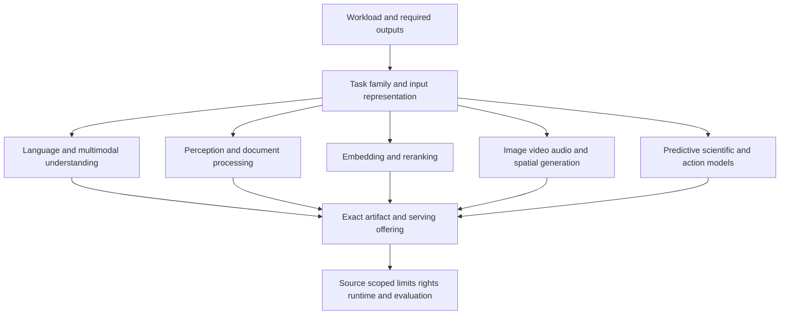

# Model taxonomy and coverage beyond LLMs

Issues: #4/#5/#6/#7 · Research date: **2026-10-17** · Status: proposed research for owner review; not a new canonical contract or a claim to enumerate every model ever released.

The earlier four-model table was a language/multimodal-generation slice. The broader question is which **task, input/output representation, artifact and serving route** fit a workload. A model architecture (transformer, diffusion/flow, CNN, graph network, tree ensemble), a task family and a product are different axes. The taxonomy below is a proposed research index, not a scientific claim that there is one universal partition of AI models.

## Read the evidence

The [JSON inventory](model-research-inventory.json) currently contains **248 candidate records**, not 248 independently pinned deployable models: it explicitly distinguishes models, bundles, families, unpinned services and training recipes. Its **55 research task tags** can overlap. Each record resolves to one or more of **189 primary source groups** in [the register](model-research-sources.md), comprising **237 distinct URLs** at this checkpoint. Counts are **derived from this corpus**, not market size, popularity or quality. All new observations are dated 17 October; [earlier research citations](citation-audit-2026-10-17.md) retain their original dates.

| Research territory | Task families investigated | Detailed sourced comparison |
| --- | --- | --- |
| Language and discriminative NLP | Reasoning/generation, code, translation, encoder representations, token classification, moderation, multimodal understanding | [Language models](language-models.md); primary groups R01-R08/R26-R29 |
| Vision perception and documents | Classification/representation, object detection, segmentation, pose, tracking, depth/camera geometry, OCR and layout | [Perception models](perception-models.md); P01-P17/P34-P42 |
| Retrieval representations | Text/multimodal embedding, dense/sparse/multivector outputs and reranking | [Retrieval models](retrieval-models.md); P06/P18-P33/P43-P54; handoff to #14, not ownership transfer |
| Generative and editable media | Image generation/editing/restoration, video/audio generation/editing, motion/avatar transfer, 3D assets/PBR, spatial/world models and action-conditioned prediction | [Generative media](generative-media-models.md); B01-B50/R30 |
| Speech and audio | ASR, speech translation, alignment, diarization, synthesis, voice conversion/design, full-duplex conversation, music/sound generation, audio QA/classification/embedding, separation/enhancement and VAD | [Audio models](audio-models.md); U01-U14/W01-W23/C01-C18 |
| Predictive/scientific/embodied | Tabular classification/regression, anomaly/temporal classification, forecasting, recommendations, graph learning, weather, geospatial, molecular/genomic/materials and robot action policies | [Specialized models](specialized-models.md); R09-R25, with embodied B45/B46 |

Figure: proposed selection flow, authored for this research. It is not an approved builder implementation or a vendor capability claim.

## What the research changes

1. **Model identity is not a UI brand or a toolkit.** Runway reseller labels differ from publisher ModelArk/xAI/MiniMax IDs; Midjourney documents UI access without a general API; HSTU/Graphormer/classical estimators need an actual fitted artifact. Model bundles and multi-stage pipelines retain constituent identities. Evidence:B16/B32-B44, R22-R25, P41/P42.
2. **Open weights are not one permission class.** ConvNeXtV2 weights differ from its MIT code; ColPali adapter/backbone terms differ; FLUX4B/9B/3Action, TimesFM2.5/3.0 and Tencent/MiniMax/LTX releases have different conditional grants. Exact primary licence/card/revision controls the research statement; no blanket commercial clearance follows. Evidence:P36/P43/P44, B09/B20/B22/B23/B36/B46, R10/R18-R21.
3. **Representation matters.** A pooled embedding, vocabulary sparse vector, patch/token matrix, pixel mask, speaker activity tensor, action chunk, mesh/PBR asset, multispectral frame and molecular structure are not interchangeable outputs. Evidence:P22/P43-P47, C12/C13, B23-B25/B45, R14-R21.
4. **Limits need the right unit and direction.** Seconds, audio samples/channels, characters, frames/fps, pixels, voxels, rows/features, time steps, residues/bases and action horizons cannot be inserted as text-token maxima. Input/output/shared budgets and task-stage constraints remain separate. Evidence:B02/B04/B17/B21/B24/B25, U08/C03-C05, R09-R17; existing frozen schema below.
5. **Availability is route- and time-specific.** Sora's retired API does not make downloadable Whisper retired; an Imagen Gemini-route shutdown does not establish another cloud route's lifecycle. Floating API aliases differ from dated snapshots and immutable repository revisions. Evidence:B01/B03/B10/B11, U04/W01/U13, R01/R04.
6. **Checked documentation does not establish workload quality.** No inference, paid API, GPU run, robot execution or scientific validation was performed for these new rows. Current source conflicts are preserved, including Adobe payload fields, Voyage route defaults, VibeVoice restrictions, Qwen Omni licence linkage and OpenVLA card/base-model conditions. Evidence:B30/B31, P24/P25, C07/C17, R21.

## Selection fields to carry forward

These are **research requirements** for #40/affected-owner discussion, not extra fields inserted into frozen v1.

| Field group | Types and units | Evidence / validation requirement |
| --- | --- | --- |
| Task and output contract | Task tags; typed role/shape/coordinate or label-schema IDs | Exact checkpoint/endpoint documentation; distinguish generation/classification/ranking/representation and pipeline stages |
| Identity and artifact role | Publisher ID, provider ID, release/snapshot/revision, adapter/base links, bundle members, voice/embodiment variant | Primary release/card/config/license; alias policy and constituent hashes separately from package version |
| Deployment and access | Operator/capacity mode per serving component; API/weights/UI/access gating/entitlement | Preserve accepted #3 taxonomy. A UI-only service must not get a fabricated v1 api/weights access value |
| Non-text admission limits | Structured name/value/unit plus input/output role, hard/recommended/training/example qualifier and conditions | Publisher specification for exact route/version. Example durations, training lengths and buffering intervals are not universal inference maxima |
| Vision and document processing | Pixels/bytes/pages, rendering/tiling, masks/boxes/coordinates, crop/normalization, label/keypoint topology | P01-P17/P36-P42; rendered PDF is not automatically equivalent to raw image or text |
| Embedding and ranking | Representation family, dimension alternatives/default, normalization/pooling, similarity/index metric, query/document/media limits | P18-P33/P43-P54; retain T3#14 and vector/index consumers' review |
| Speech/audio/video | Sample rateHz, channels, codec, seconds/frames/fps, stream mode, speaker count, language direction, synchronization | U/W/C and B source groups; retain stream-vs-file and native-vs-upscaled distinctions |
| Spatial/scientific/action | Coordinate/reference frame, depth units/scale, topology/PBR/splat format, sensor bands, forecast grid/horizon, molecular alphabet, robot action space | B23-B28/B45, R09-R23; no inferred real-world calibration or domain suitability |
| Rights and conditions | Separate code/checkpoint/base/adapter/dependency/service/output/reference-data terms; gating, territory and answerable conditions | Actual governing source and version, not a metadata badge alone. #30/#40/#41 interpret concrete use, derivatives and rights |
| Runtime and resource inputs | Exact artifact precision/packing/backend, pre/postprocessing, shape/batch/stream state, per-stage memory | #10/#11 own sizing and joint support. Do not transfer autoregressive text KV formulas to arbitrary diffusion, vision or scientific models |
| Evaluation | Workload-selected quality target, dataset/task/version/settings and metric units | #36 owns protocol; vendor-relative rankings, accuracy/latency/clinical/forecast claims stay unverified unless matched evidence exists |
| Pricing | Dated meter/conditions, provider/route, region/currency and retry/minimum/tier accounting | #39 owns aggregation; new image/video/audio/character/credit meters cannot be silently disguised as supported v1 units |

## Frozen-contract implications

Current [`spec_model`](../../contracts/v1/schemas/catalog-item.schema.json) permits only `generative`, `multimodal`, `reranker`, `embedding`, requires positive `context_window_tokens` and `max_output_tokens`, and uses the five modality names text/image/audio/video/structured. These fields cannot truthfully force-complete every candidate above. [`spec_embedding_model`](../../contracts/v1/schemas/catalog-item.schema.json) likewise does not fully encode sparse/multivector outputs or all selectable dimension/route alternatives.

Propose **T1-TAX1** through #40: task-specific output/admission semantics, artifact composition and rights conditions, building on accepted CD-5/CD-6/CD-7/CD-9/CD-11 routing. Preserve existing shared-window records and migrate readers deliberately; do not invent context maxima for non-token models or rename mesh/DNA/action semantics to ordinary text. [Contract proposal](model-family-contract-proposal.md) gives examples and owners. No imported contract, generator or final Ruleset is changed by this inventory.

## Coverage and remaining work

The corpus covers the named task tags with documentary examples, API/weight contrasts and explicit gaps. It does **not** establish an exhaustive census of all providers/checkpoints or complete rights/runtime/price facts for every row. Unexamined neighboring variants include additional image/video/3D vendors, vision/OCR families and domain embeddings. Gated cards, proprietary terms, checkpoint-specific licences, serving aliases and quality remain explicit research gaps. A failed page load is not absence of a capability.

Next passes should prioritize a gap that changes a user's decision: missing family, route, output representation, licence condition or required supported contract field. Expanding every duplicate size/quantization without a material difference is not evidence of a new task family. #14 retains embedding catalog ownership; #30 rights sufficiency, #10/#11 resources/runtime, #36 evaluation, #39 meters and #40/#41 contract/evidence decisions still need real dispositions. The user-approved long-running goal remains broader than this reviewable contribution.

## Method and provenance

Independent source territories were collected in parallel, followed by an expansion pass for missing perception/retrieval, commercial media/action and audio subtypes, then a root specialized/NLP pass and the retrospective citation audit. Publisher-controlled identities/specifications use explicit primary-only source exceptions; no source is relabelled independently verified because it was fetched. Contradictions and failed reads are recorded in the rows. [Source register](model-research-sources.md), [inventory](model-research-inventory.json), [old-source audit](citation-audit-2026-10-17.md) and [market citation map](../market/citation-index-2026-10-17.md) provide the inspectable trail.
