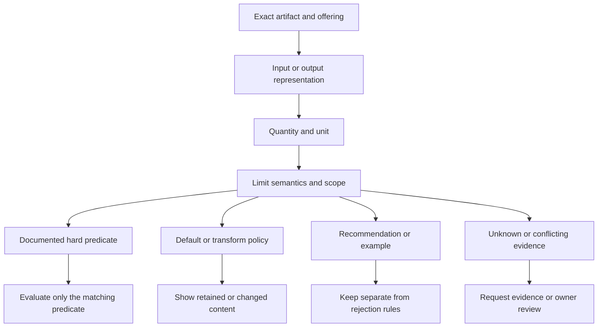

# Non-text model selection limits

Issues: #5, #6, #7; central review: #40. **Status: partial research for review; no owner acceptance or approved compatibility rules.** Sources inspected **2026-10-17**.

## Scope and evidence

This supplement records **55 evidence/unknown records across four territories and 37 source groups** (65 distinct source URLs on 12 domains, fragments deduplicated). Counts are derived from the companion [research JSON](nontext-limit-evidence.json); they are not independently tested model counts. The JSON is a research note, not a CatalogItem, Pricebook or measured run.

Each record preserves model/route, stage, unit, limit semantics, source revision/access date and decision consequence. Model configuration, wrapper cap, service limit, default, training shape, recommendation and example are distinct evidence. All observations remain **source checked, unverified as runtime behavior**. No paid calls, inference, weights, raw datasets or private inputs were used. Model quality, hardware fit, clinical utility and legal clearance are not established.

The existing [model](ai-model.md), [provider](model-provider.md), [context](context-window.md) and [handoff](handoffs.md) records remain canonical. Embedding/retrieval decisions remain with #14/#15/#16; #10/#11 own resource/runtime evidence, #36 evaluation and #39 pricing.

## Selection fields and rule consequences

These are research requirements for #40, not properties added to frozen v1.

| Field | Meaning |
| --- | --- |
| Artifact and offering identity | Exact checkpoint/revision or endpoint/model/API version; mutable aliases retain observation date |
| Direction and stage | Input, output, session, preprocessing, intermediate representation or service request |
| Quantity and unit | Text/codec tokens, phoneme/text characters, samples, seconds, frames, pixels, time points, variates, rows, features, classes, residues or processed atom tokens |
| Semantics | Hard documented predicate, configured wrapper policy, transform, default, recommendation, training shape, example or unknown |
| Combination and scope | Per item/batch/series/chunk/request/head, attention mode, media resolution, hardware and extension lineage |
| Transform and retained content | Truncation, padding, resampling, cropping, upscaling, tokenization, covariate subsampling and target splitting |
| Evidence and uncertainty | Source/revision/date, source conflicts and unavailable facts; checking is not independent reproduction |

Figure: project-authored research flow for interpreting the evidence below; not an implemented rule engine.

## Speech and audio

| ID / model and route | Documented value and unit | Meaning and retained conditions | Selection consequence | Evidence |
| --- | --- | --- | --- | --- |
| **AU-01** OpenAI Whisper; local transcribe() | 30-second sliding windows; 16000 Hz **seconds; Hz** (input) | **processing window, not whole-file maximum.** Whole file is processed over repeated windows. | Separate chunk/window configuration from file admission. | [AU-S1](#au-s1) |
| **AU-02** OpenAI hosted transcription; Transcriptions guide versus legacy whisper-1 FAQ | guide: 25 MB file; FAQ: 25 MiB legacy request **publisher MB/MiB** (input) | **unresolved unit/scope discrepancy.** Newer GPT-4o routes may use different duration/token validation. No exact common byte threshold established. | Do not normalize into a universal size or audio duration maximum. | [AU-S2](#au-s2) |
| **AU-03** OpenAI Realtime; speech-to-speech session | 60 **minutes** (session) | **documented maximum.** This is a session lifetime, not individual input/output audio duration or every voice route. | Represent connection/session expiry separately from media admission. | [AU-S3](#au-s3) |
| **AU-04** eleven_v3; ElevenLabs TTS API | 5000 **characters** (input) | **documented request maximum.** Exact character-count algorithm is not established by this page; approximate audio minutes are not output-duration caps. | Preserve character accounting and API identity; do not substitute tokens/words. | [AU-S4](#au-s4) |
| **AU-05** eleven_multilingual_v2; ElevenLabs TTS API | 10000 **characters** (input) | **documented request maximum.** Exact character-count algorithm is not established by this page; approximate audio minutes are not output-duration caps. | Preserve character accounting and API identity; do not substitute tokens/words. | [AU-S4](#au-s4) |
| **AU-06** eleven_flash_v2_5; ElevenLabs TTS API | 40000 **characters** (input) | **documented request maximum.** Exact character-count algorithm is not established by this page; approximate audio minutes are not output-duration caps. | Preserve character accounting and API identity; do not substitute tokens/words. | [AU-S4](#au-s4) |
| **AU-07** ElevenLabs website TTS; website generation | paid: 5000; free: 2500 **characters per generation** (input) | **plan-specific product maximum.** Website product limits differ from API model maxima. | Provider/model/plan/route must be separate selection attributes. | [AU-S5](#au-s5) |
| **AU-08** Qwen3-ASR; official wrapper, transcription without timestamps | 1200 seconds; 16000 Hz; boundary search 5 seconds around target **seconds; Hz** (input) | **chunk target, not whole-input rejection maximum.** Low-energy boundary choice can exceed the nominal target. Longer audio is split. | Name chunking strategy, timestamp mode and actual retained chunks. | [AU-S6](#au-s6) |
| **AU-09** Qwen3-ASR / ForcedAligner-0.6B; wrapper with return_time_stamps=true versus aligner README | wrapper target 180 seconds; aligner card up to 5 minutes **seconds; minutes** (input) | **stage-specific wrapper target versus advertised capacity.** Wrapper and aligner statements describe different stages; boundary-search caveat remains. | Do not impose wrapper chunk duration as the aligner model's universal maximum. | [AU-S6](#au-s6) |
| **AU-10** Kokoro-82M; pinned raw phoneme-string pipeline and model | raw phoneme path rejects >510 characters; model reserves 2 of 512 positions **phoneme characters; token positions** (input) | **path-specific hard check and positional configuration.** Recognized phoneme token IDs and natural-language graphemes are different representations; other paths chunk/truncate. | Keep representation and processor path, rather than declaring a 510-character natural-language ceiling. | [AU-S7](#au-s7) |
| **AU-11** Dia; voice-cloning reference | 5-10 **seconds** (input) | **recommendation.** Not an evidenced rejection threshold or maximum output duration. | Show recommendation separately from hard admission predicates. | [AU-S8](#au-s8) |
| **AU-12** Parakeet-TDT-0.6B-v3; full attention; publisher A100 80GB condition | up to 24 **minutes** (input) | **conditional documented capacity, not proven rejection cap.** Card says supported input size depends on RAM. | Do not transfer a hardware-conditioned capacity to an arbitrary runtime. | [AU-S9](#au-s9) |
| **AU-13** Parakeet-TDT-0.6B-v3; local attention | up to 3 **hours** (input) | **mode-specific supported capacity.** Card does not separately bind the local-attention figure to specified hardware; no universal hard maximum established. | Preserve attention mode and unresolved hardware scope. | [AU-S9](#au-s9) |
| **AU-14** Qwen3-TTS-12Hz-1.7B-Base; pinned checkpoint plus wrapper | checkpoint 8192; wrapper fallback/evaluation 2048; lower-level signature 4096 **codec tokens** (output) | **overridable generation default.** User override precedes checkpoint default; stages differ. EOS may finish earlier. | Store effective generation settings; do not claim an architectural ceiling or exact audio duration. | [AU-S10](#au-s10) |
| **AU-15** Qwen3-TTS-12Hz-1.7B-Base; complete audio request | unknown **seconds** (output) | **unknown hard duration maximum.** Internal positional sizes and max_length fields do not establish a universal duration maximum. | Retain unknown rather than converting codec tokens to a guaranteed number of seconds. | [AU-S10](#au-s10) |
| **AU-16** eleven_v4; ElevenLabs TTS API | 10000 **characters** (input) | **documented request maximum.** Current model table; approximate audio duration is not a guaranteed output cap. Character-count implementation remains unspecified here. | Keep exact model ID and text-accounting policy with the selected route. | [AU-S4](#au-s4) |

## Image and video

| ID / model and route | Documented value and unit | Meaning and retained conditions | Selection consequence | Evidence |
| --- | --- | --- | --- | --- |
| **ME-01** FLUX.2; /v1/flux-2-pro | minimum 64x64; 16-pixel dimension increments; maximum 4 MP (publisher notation); <=2 MP recommended **pixels; megapixels** (output) | **documented shape budget versus recommendation.** 2048x2048 is an example, not the sole maximum geometry. Do not silently treat publisher 4 MP notation as exactly 4,000,000 pixels. | Distinguish per-axis grid, total area and recommended operating size. | [ME-S1](#me-s1) |
| **ME-02** FLUX.2 editing; API /v1/flux-2-pro-preview versus playground | 8 API versus 10 playground **reference images** (input) | **route-specific reference count.** Docs identify /v1/flux-2-pro as pinned; preview examples are not its immutable revision proof. | Product UI capacities must not be copied onto an API route. | [ME-S2](#me-s2) |
| **ME-03** FLUX3 video; /v1/flux-3-video; version=latest | whole seconds 5-20 or auto **seconds** (output) | **documented duration enum/range and mutable version.** Only latest is currently offered; do not invent a dated version. | Bind limits to a dated observation and effective version; auto is not an explicit user duration. | [ME-S3](#me-s3) |
| **ME-04** FLUX3 video; 16:9 resolution selection | hd 1280x704; fhd 1920x1088; qhd 2560x1440; uhd 3840x2176 **pixels** (output) | **delivered shapes and upsampling.** Higher classes use upsampling; draft requires hd. | Avoid assuming conventional 720p/1080p/2160p shapes or native generation at delivered resolution. | [ME-S3](#me-s3) |
| **ME-05** Runway gen4.5; POST /v1/image_to_video; X-Runway-Version=2024-11-06 | integer duration 2-10; 1280:720, 720:1280, 1104:832, 960:960, 832:1104, 1584:672 **seconds; output pixels** (output) | **endpoint duration and aspect-ratio enums.** Image position is first; other models' last-frame capability is not inherited. | Validate model-discriminated body and allowed combinations, not arbitrary image dimensions. | [ME-S4](#me-s4) |
| **ME-06** Gemini image models; /v1beta/interactions | nano-banana-2.1: 1K/2K/4K, not 512px; 3.1-flash-image supports 512px; 3.1-flash-lite-image: 1K only **publisher size tier** (output) | **model-specific size-tier support.** Current new-project choice and older model routes differ. | A shared image-generation interface does not make every size valid for every model. | [ME-S5](#me-s5) |
| **ME-07** gemini-nano-banana-2.1; 4K output tier | 1:1 4096x4096; 16:9 5504x3072; 8:1 12288x1536 **pixels** (output) | **ratio-dependent delivered dimensions.** 4K is a tier label; not a universal maximum edge. | Use the exact ratio/size table rather than treating 4096 as a width cap. | [ME-S5](#me-s5) |
| **ME-08** gemini-nano-banana-2.1 versus 2.5-flash-image; reference inputs | 2.1:14 total, fidelity categories 10 objects/4 characters; 2.5:3 works-best inputs **reference images** (input) | **documented capacity versus optimization guidance.** Reference acceptance and identity fidelity are separate claims. | Do not turn an optimization recommendation into a hard rejection threshold. | [ME-S5](#me-s5) |
| **ME-09** Veo3.1 / Fast preview; predictLongRunning generation | 4/6/8 seconds; 16:9 or9:16; 24fps; 1 video; 1080p/4K or reference images require 8s; <=3 references **seconds; frames/second; counts** (output) | **conditional duration/resolution/reference combinations.** Restricted to 3.1/Fast preview; do not copy older Veo table values. | Validate combinations rather than independent maxima. | [ME-S6](#me-s6) |
| **ME-10** Veo3.1 / Fast extension; prior Veo-generated video only | input <=141s at720p; each extension7s; up to 20 extensions; output<=148s **seconds; extension count** (input_and_output) | **extension-specific limits.** 16:9/9:16; Lite lacks extension. This is not arbitrary upload support or single-generation length. | Treat extension lineage, resolution and cumulative duration as separate predicates. | [ME-S6](#me-s6) |
| **ME-11** Gemini video understanding; example gemini-3.8-flash interactions route | 1fps default static sampling; 1M-context models up to 3h low media resolution or1h high **frames/second; hours** (input) | **sampling default and context/resolution-conditioned capacity.** Configurable sampling and agentic processing differ; no universal duration or native-frame inspection established. | Store sampling and resolution with admission/quality inputs. | [ME-S7](#me-s7) |
| **ME-12** FLUX3 image; POST /v1/flux-3-image; version=latest | optional references1-10; tiers768sq/1k/1.5k/2k/4k; default 1k **reference images; publisher size tier** (input_and_output) | **documented reference count and equal-area size tier.** No exact per-ratio dimensions or numerical total-pixel ceiling established; count is field description rather than maxItems schema proof. | Do not import FLUX.2's 4MP ceiling or interpret tier name as edge length. | [ME-S8](#me-s8) |
| **ME-13** gpt-image-2.5-sunburst / flare; direct image output; 2026-09-08 snapshots | each edge<=3840 and divisible by16; ratio<=3:1; area655360..8294400; area>3686400 experimental **pixels; aspect ratio** (output) | **joint hard shape predicates plus experimental threshold.** Current guide permits 3840 edges, while an older cookbook says less than3840; retain current-source scope. | Check area, ratio and per-axis grid together; experimental does not mean prohibited. | [ME-S9](#me-s9) |
| **ME-14** gpt-image-2.5-sunburst / flare; POST /v1/images/edits | up to 16 input references; 1-10 output images **images** (input_and_output) | **endpoint count and model-specific parameter behavior.** Pin dated model IDs instead of current default. GPT Image2 high fidelity is automatic; omit input_fidelity per guide. | Counts do not guarantee identity fidelity; older parameter controls need route-specific checking. | [ME-S9](#me-s9) |
| **ME-15** Mistral OCR / Document AI; OCR cookbook versus Files API | OCR typical ~50MB/~1000 pages; Files API upload512MB **publisher MB; pages** (input) | **typical processing estimate versus separate upload maximum.** Exact current OCR-model processing ceiling remains unknown. Files upload does not establish inference acceptance. | Leave exact OCR hard admission unknown rather than using the largest upstream upload value. | [ME-S10](#me-s10) |

## Embedding and reranking representations

| ID / model and route | Documented value and unit | Meaning and retained conditions | Selection consequence | Evidence |
| --- | --- | --- | --- | --- |
| **EL-01** Cohere embed-v4.0 versus embed-v5.0-pro/fast; direct /v2/embed | v4: 256, 512, 1024, 1536(default); v5: 256, 512, 768, 1024, 1536, 2048(default) **vector dimensions** (output) | **allowed dimensions and defaults.** Different model generations; source lists 128k input tokens for each, in publisher notation. | Persist selected dimension and model identity with the index. Do not transfer v5's default to v4 or assume equal dimension means equal embedding space. | [EL-S1](#el-s1) |
| **EL-02** Cohere Embed v2 API; direct /v2/embed | texts: 96; inputs: 96; v4+ images combined: 20 MB; truncate default END **items; publisher MB; truncation policy** (input) | **endpoint batch/size limits and default truncation.** Current v2 reference does not impose an image-count limit for v4+; older v1 guide states up to 96 v4 images. Treat parameter/API version and image bytes separately. NONE returns an overlength error. | Never present successful default truncation as preservation of every input token. Avoid one brand-wide image-count cap. | [EL-S1](#el-s1) |
| **EL-03** voyage-4-large / voyage-4 / voyage-4-lite; direct v1 embeddings; Python embed() | 32, 000 per text; at most 1, 000 texts; aggregate 120K / 320K / 1M tokens respectively **tokens; texts** (input) | **per-text versus aggregate batch admission.** Selected output dimension 1024(default), 256, 512 or 2048. Do not infer missing voyage-code-4 batch semantics from voyage-code-3. | Check both item and batch budgets. Splitting a batch does not repair a too-long individual item. | [EL-S2](#el-s2) |
| **EL-04** Voyage text embeddings; direct v1 embeddings | truncation=true by default; false raises overlength error; binary/ubinary returned integer-list length = output_dimension / 8 **policy; packed bytes per vector** (input_and_output) | **documented default transform and packed output layout.** Applicable model/dtype support remains source-specific; the logical vector dimension is not the returned packed-list length. | Store the effective transform and logical dimension/dtype. Do not interpret a 128-element packed result as a 128-dimensional float vector. | [EL-S2](#el-s2) |
| **EL-05** voyage-context-4; contextualized embeddings; auto-chunking mode | 32, 000 per chunk; 120, 000 total with auto-chunking, otherwise 32, 000; target chunk default 512 **tokens** (input) | **conditional total/chunk limits and default target.** The overview footnote uses enable_auto_chunk while the SDK signature uses enable_auto_chunking. Target chunk size/overlap are upper bounds, not guaranteed exact segmentation; custom client chunk_fn cannot combine with server auto-chunking. | Pin SDK/server parameter mapping and actual returned chunk_texts. A larger total window does not enlarge every chunk. | [EL-S3](#el-s3) |
| **EL-06** Qwen/Qwen3-Embedding-0.6B; pinned open-weight card/config | card: 32K sequence; pinned config max_position_embeddings=32768; dimensions 32..1024; example max_length=8192 **tokens; vector dimensions** (input_and_output) | **published sequence/configuration versus runnable example.** The example's truncation limit is not the card's model ceiling. Configuration and card do not establish runtime quality/admission at every length. | Record the actual preprocessing limit and selected dimension separately from the model's published/configured capacity. | [EL-S4](#el-s4) |
| **EL-07** BAAI/bge-m3; pinned publisher card | 8192 input tokens; dense dimension 1024; dense, sparse and multi-vector outputs **tokens; vector dimensions; representation kind** (input_and_output) | **published sequence limit and multiple retrieval representations.** Example max_passage_length=128 is a configured speed/length choice, not the published model maximum. | Require the consumer's dense/sparse/late-interaction representation support, in addition to length and any dimension check. | [EL-S5](#el-s5) |
| **EL-08** vidore/colpali-v1.3; pinned card and Sentence Transformers dense-layer config | out_features=128; card example query (28, 128) and document (1030, 128) **vector dimensions per token/patch; example sequence lengths** (output) | **multi-vector projection versus variable sequence shape.** 28 and 1030 are illustrated shapes, not universal token/patch counts. The card documents MaxSim late interaction and processor-prefix differences across engine versions. | A single-vector dimension equality check cannot certify compatibility. Pin processor/runtime and score method as part of retrieval identity. | [EL-S6](#el-s6) |
| **EL-09** intfloat/multilingual-e5-large; pinned publisher card | long texts truncated to at most 512 tokens **tokens** (input) | **documented truncation behavior and task formatting.** Card FAQ requires task-appropriate query/passage prefixes; input formatting is separate from the retained sequence cap. | Keep preprocessing/prefix policy and truncation visible. Do not market unchanged handling of longer documents. | [EL-S7](#el-s7) |
| **EL-10** jinaai/jina-embeddings-v4; pinned publisher card; open-weight mode | 32768 sequence; dense default 2048, selectable 128/256/512/1024/2048; multi-vector width 128 **tokens; vector dimensions** (input_and_output) | **published sequence and representation dimensions.** Card's Sentence Transformers section directs multi-vector users to the Hugging Face model directly. The examined wrappers are not interchangeable. | Persist vector_type and supported wrapper alongside dimension. A wrapper exposing only dense output does not prove multi-vector availability. | [EL-S8](#el-s8) |

## Forecasting, tabular and scientific models

| ID / model and route | Documented value and unit | Meaning and retained conditions | Selection consequence | Evidence |
| --- | --- | --- | --- | --- |
| **PR-01** Chronos2; checkpoint plus current pipeline | 8192 **time steps per series** (input) | **configured retained-history cap.** Larger requested context is clamped; total dataframe rows may include many series. | Group by series and retained history rather than treating every row as one token. | [PR-S1](#pr-s1) |
| **PR-02** Chronos2; pipeline prediction_length guard | 1024 (=64 output patches x16 steps) **future time steps** (output) | **default model length with explicit override.** limit_prediction_length rejects overlength when enabled; disabling allows continuation with warning. No quality guarantee for longer forecasts. | Separate configured capability, guard policy and actual requested horizon. | [PR-S1](#pr-s1) |
| **PR-03** TimesFM3.0; pinned PyTorch forecaster | 15360 **time points** (input) | **wrapper retained-context cap.** Longer target histories/covariates are sliced; earlier2.5 16k statement is not this wrapper. | Pin wrapper revision and report retained/discarded history. | [PR-S2](#pr-s2) |
| **PR-04** TimesFM2.5; publisher release plus example | context up to 16k; quantile forecasting up to 1k; example max_context1024/max_horizon256 **time points; future steps** (input_and_output) | **published input capability and optional quantile-head horizon.** Source k notation retained. Quantile-head horizon is not an unconditional point-forecast cap. | Keep task/head and example/runtime settings separate. | [PR-S3](#pr-s3) |
| **PR-05** TimesFM2.0; pinned card | training context 2048; example/usage maximum ambiguity; arbitrary horizons described **time points; future steps** (input_and_output) | **training context with internally qualified inference description.** Card permits extrapolation past training context, while usage describes currently handled2048; horizon<=context is recommended, not required. | Preserve internal source ambiguity and inspect chosen wrapper rather than inventing one universal ceiling. | [PR-S4](#pr-s4) |
| **PR-06** MOMENT1-large; checkpoint and model input | seq_len512; patch length/stride8; forecasting example horizon 96 **time points; steps** (input_and_output) | **configured window versus output example.** Input is batch xchannels xsequence; univariate pretraining is not proof of one-channel-only inference. No universal output cap verified. | Treat96 as example and retain actual task head/channel configuration. | [PR-S5](#pr-s5) |
| **PR-07** TabPFN v2; version-specific default inference configuration | 10000 samples; 500 features; 10 classes **samples; features; classes** (input) | **intended operating-range configuration.** Source describes sample/feature values as intended pretraining range including extrapolation; not necessarily literal largest training dataset. | Keep dataset axes and configuration semantics separate from architectural hard maxima. | [PR-S6](#pr-s6) |
| **PR-08** TabPFN v2.5; post-v2 checkpoint-loaded configuration | fallback function50000 samples/2000 features/10 classes; loaded checkpoint limits not established here **samples; features; classes** (input) | **withdrawn fallback-as-cap inference; actual limit unresolved.** get_default explicitly says post-v2 inference config comes from checkpoint and this function is not called. No weights downloaded. | Do not publish the fallback's50000 as the selected checkpoint's operating cap. | [PR-S6](#pr-s6) |
| **PR-09** TabPFN3.5; publisher card and public config | card feature limit 20000; row/class maxima unknown **features; samples; classes** (input) | **published feature bound; row/class constraints unknown.** Public config contains only model name; newer checkpoint metadata not downloaded. Text/datetime columns remain tabular representations. | Record feature count independently; do not backfill row/class limits from older versions. | [PR-S6](#pr-s6), [PR-S7](#pr-s7) |
| **PR-10** Prithvi-EO-2.0-300M; pinned processor/checkpoint | 6 channels: Blue, Green, Red, Narrow NIR, SWIR1, SWIR2; patch[1, 16, 16] **spectral bands; patch shape** (input) | **semantic channel contract.** Expected reflectance units/order are part of the input. This is not arbitrary RGB+3 channels. | Validate semantic band mapping and normalization, not channel count alone. | [PR-S8](#pr-s8) |
| **PR-11** Prithvi-EO-2.0-300M; pretrained configuration | image size224; 4 frames **pixels; temporal frames** (input) | **configuration/pretraining shape, not proven hard maximum.** Chronological observations at same location; selected implementation's resize/interpolation/frame flexibility not established. | Do not turn224 into geographic extent/resolution or a global token cap. | [PR-S8](#pr-s8) |
| **PR-12** AlphaFold3; local implementation | largest default bucket5120; larger inputs create new bucket/recompile **processed model tokens** (input) | **default compilation bucket versus extensible input.** Local bucket behavior does not establish hosted limits, hardware fit or successful/accurate execution at larger size. | Do not label the largest preset bucket as global molecule-size cap. | [PR-S9](#pr-s9) |
| **PR-13** TimesFM3.0; benchmark evaluator only | budget 32 includes targets+past-future covariates+past-only covariates **variates** (input) | **route-specific variate budget and transforms.** Overflow subsamples covariates and chunks targets; general forecaster hard variate cap remains unestablished. | Expose transformations and lost cross-target/covariate information; do not claim a global32-variate prohibition. | [PR-S2](#pr-s2) |
| **PR-14** AlphaFold3; local tokenizer with default nonstandard flattening | standard polymer:1 token/residue; represented ligand:1 token/atom; nonstandard residues flattened with protein MSE exception **processed residue/atom tokens** (input) | **representation-specific token accounting.** Count the processed output atom layout; a chemical string atom count or raw residue count is insufficient. | Use the actual tokenizer/processing policy for mixed complexes; do not invent a universal atom maximum. | [PR-S9](#pr-s9) |

## Corrections and unresolved evidence

- **TabPFN fallback correction (PR-08):** the initial pass found a v2.5 fallback sample count. The skeptical pass found newer inference configs come from checkpoints. The fallback is retained as a code value and withdrawn as an operating cap. Public TabPFN3.5 metadata does not establish row/class maxima.
- **Source conflicts stay visible:** OpenAI upload MB/MiB statements, Cohere image-parameter versions, TimesFM2.0 training/inference wording and older/current image-edge wording are not collapsed into an unsupported universal number. No API rejection was observed.
- **Defaults do not establish physical ceilings:** Qwen TTS codec budgets, Chronos guards, AlphaFold buckets and preprocessing examples remain distinct from hard limits.
- **Unknowns:** exact current OCR processing limits; FLUX3 image numerical pixel budget; Qwen TTS hard duration; Parakeet local-attention hardware scope; TabPFN3.5 row/class checkpoint limits; TimesFM general-forecaster variate cap; end-to-end quality/resource behavior.
- **Collection boundary:** initial audio/media/predictive lanes were followed by targeted expansion of Qwen TTS/Parakeet, FLUX3/GPT Image/OCR and checkpoint/tokenizer semantics. Root checks covered embeddings and interpretation. Remaining gaps need more-specific disclosure, permitted checkpoint metadata or authorized runtime evidence; they are not filled with guesses.

## Cross-family implications and handoffs

These are requests for review, not receiving-owner acknowledgements.

| Consumer | Evidence/decision requested | State |
| --- | --- | --- |
| #5 | Preserve route, API/product plan, alias and parameter identity | Pending |
| #7 | Apply token predicates only where units/semantics match; preserve transforms | Pending |
| #10/#11 | Carry retained shapes, mode, chunking, dtype and wrapper revision; measure resource claims | Pending |
| #14/#15/#16 | Confirm dense/sparse/multivector, packed dtype, dimension and processor compatibility; separate item/batch budgets | Pending |
| #30/#41 | Review artifact/route rights independently; this supplement supplies no new rights approval | Pending |
| #36 | Define task quality checks and assess information discarded by transforms | Pending |
| #39 | Separate billing units from admission and account for chunked/transformed work without invented rates | Pending |
| #40 | Review typed conditional stage-specific limits and migration; never force seconds/rows/pixels into token fields | Pending |

Frozen v1 remains unchanged. A positive token ceiling cannot substitute for a non-token constraint; one embedding dimension cannot express every sparse/multivector or packed representation. No final ruleset is emitted. Existing issue criteria and real owner handoffs still govern completion.

## Verification and practical limits

Repository checks validate import integrity, schemas, references and intake shape. They neither ingest arbitrary research JSON as production data nor prove external facts. Explicit checks cover source IDs, dates, URLs, required note fields and local links.

Pinned constants/configurations were read for Whisper, Qwen ASR/TTS/embeddings, ColPali, MOMENT, Chronos, TimesFM and TabPFN checkpoint precedence. Synthetic arithmetic checks exercise joint image predicates, separate item/batch budgets and packed-vector length. They are **not model/API execution, performance tests or approved compatibility outcomes**. Exact data and current-source interpretations still require review.

## Sources

All groups were accessed **2026-10-17**. Mutable-page update dates are separate from access dates; code/config revisions are pinned. Full mapping: [nontext-limit-evidence.json](nontext-limit-evidence.json).

### EL-S1

Cohere. Scope: Direct Cohere v2 Embed API; model rows distinguish v4/v5. Revision: mutable documentation accessed 2026-10-17. Source-checked primary evidence; runtime verification remains unverified.

- [Primary source 1](https://docs.cohere.com/docs/cohere-embed)
- [Primary source 2](https://docs.cohere.com/v2/reference/embed)
- [Primary source 3](https://docs.cohere.com/v1/docs/embeddings)

### EL-S2

Voyage AI. Scope: Voyage v1 text embeddings API. Revision: mutable documentation accessed 2026-10-17. Source-checked primary evidence; runtime verification remains unverified.

- [Primary source 1](https://docs.voyageai.com/docs/embeddings)
- [Primary source 2](https://docs.voyageai.com/reference/embeddings-api)

### EL-S3

Voyage AI. Scope: voyage-context-4; SDK and server auto-chunking conditions. Revision: mutable documentation accessed 2026-10-17. Source-checked primary evidence; runtime verification remains unverified.

- [Primary source 1](https://docs.voyageai.com/docs/contextualized-chunk-embeddings)

### EL-S4

Qwen. Scope: Qwen/Qwen3-Embedding-0.6B. Revision: 97b0c614be4d77ee51c0cef4e5f07c00f9eb65b3. Source-checked primary evidence; runtime verification remains unverified.

- [Primary source 1](https://huggingface.co/Qwen/Qwen3-Embedding-0.6B/raw/97b0c614be4d77ee51c0cef4e5f07c00f9eb65b3/README.md)
- [Primary source 2](https://huggingface.co/Qwen/Qwen3-Embedding-0.6B/raw/97b0c614be4d77ee51c0cef4e5f07c00f9eb65b3/config.json)

### EL-S5

BAAI. Scope: BAAI/bge-m3. Revision: 5617a9f61b028005a4858fdac845db406aefb181. Source-checked primary evidence; runtime verification remains unverified.

- [Primary source 1](https://huggingface.co/BAAI/bge-m3/raw/5617a9f61b028005a4858fdac845db406aefb181/README.md)

### EL-S6

Vidore. Scope: vidore/colpali-v1.3. Revision: b5c6dd62125326e6f0b540c1f7b36e901cdc0a11. Source-checked primary evidence; runtime verification remains unverified.

- [Primary source 1](https://huggingface.co/vidore/colpali-v1.3/raw/b5c6dd62125326e6f0b540c1f7b36e901cdc0a11/README.md)
- [Primary source 2](https://huggingface.co/vidore/colpali-v1.3/raw/b5c6dd62125326e6f0b540c1f7b36e901cdc0a11/1_Dense/config.json)

### EL-S7

intfloat. Scope: intfloat/multilingual-e5-large. Revision: 3d7cfbdacd47fdda877c5cd8a79fbcc4f2a574f3. Source-checked primary evidence; runtime verification remains unverified.

- [Primary source 1](https://huggingface.co/intfloat/multilingual-e5-large/raw/3d7cfbdacd47fdda877c5cd8a79fbcc4f2a574f3/README.md)

### EL-S8

Jina AI. Scope: jinaai/jina-embeddings-v4. Revision: 853c867b65b749f3c3c72a06868140d842e04f06. Source-checked primary evidence; runtime verification remains unverified.

- [Primary source 1](https://huggingface.co/jinaai/jina-embeddings-v4/raw/853c867b65b749f3c3c72a06868140d842e04f06/README.md)

### AU-S1

OpenAI. Scope: local Whisper transcribe(). Revision: 86098128c0b4f24f0e2aa2994de830614b474227. Source-checked primary evidence; runtime verification remains unverified.

- [Primary source 1](https://github.com/openai/whisper/blob/86098128c0b4f24f0e2aa2994de830614b474227/README.md#L125)
- [Primary source 2](https://github.com/openai/whisper/blob/86098128c0b4f24f0e2aa2994de830614b474227/whisper/audio.py#L13-L17)

### AU-S2

OpenAI. Scope: hosted transcription guide versus legacy whisper-1 FAQ. Revision: mutable documentation accessed 2026-10-17. Source-checked primary evidence; runtime verification remains unverified.

- [Primary source 1](https://developers.openai.com/api/docs/guides/speech-to-text#longer-inputs)
- [Primary source 2](https://help.openai.com/en/articles/7031512-audio-api-faq)

### AU-S3

OpenAI. Scope: Realtime session lifecycle. Revision: mutable documentation accessed 2026-10-17. Source-checked primary evidence; runtime verification remains unverified.

- [Primary source 1](https://developers.openai.com/api/docs/guides/realtime-conversations#session-lifecycle-events)

### AU-S4

ElevenLabs. Scope: model-specific TTS API character limits. Revision: mutable documentation accessed 2026-10-17. Source-checked primary evidence; runtime verification remains unverified.

- [Primary source 1](https://elevenlabs.io/docs/overview/models#character-limits)

### AU-S5

ElevenLabs. Scope: website TTS plan limits. Revision: mutable documentation accessed 2026-10-17. Source-checked primary evidence; runtime verification remains unverified.

- [Primary source 1](https://elevenlabs.io/docs/eleven-creative/playground/text-to-speech)

### AU-S6

Qwen. Scope: Qwen3-ASR official Python wrapper. Revision: 7c6daf77a2421100f5fb066495372c00129d39ff. Source-checked primary evidence; runtime verification remains unverified.

- [Primary source 1](https://github.com/QwenLM/Qwen3-ASR/blob/7c6daf77a2421100f5fb066495372c00129d39ff/qwen_asr/inference/utils.py#L33-L36)
- [Primary source 2](https://github.com/QwenLM/Qwen3-ASR/blob/7c6daf77a2421100f5fb066495372c00129d39ff/qwen_asr/inference/utils.py#L246-L314)
- [Primary source 3](https://github.com/QwenLM/Qwen3-ASR/blob/7c6daf77a2421100f5fb066495372c00129d39ff/qwen_asr/inference/qwen3_asr.py#L366-L377)
- [Primary source 4](https://github.com/QwenLM/Qwen3-ASR/blob/7c6daf77a2421100f5fb066495372c00129d39ff/README.md#L65)

### AU-S7

hexgrad. Scope: Kokoro raw phoneme pipeline/model. Revision: code dfb907a02bba8152ca444717ca5d78747ccb4bec; checkpoint f3ff3571791e39611d31c381e3a41a3af07b4987. Source-checked primary evidence; runtime verification remains unverified.

- [Primary source 1](https://github.com/hexgrad/kokoro/blob/dfb907a02bba8152ca444717ca5d78747ccb4bec/kokoro/pipeline.py#L272-L277)
- [Primary source 2](https://github.com/hexgrad/kokoro/blob/dfb907a02bba8152ca444717ca5d78747ccb4bec/kokoro/model.py#L128-L131)
- [Primary source 3](https://huggingface.co/hexgrad/Kokoro-82M/blob/f3ff3571791e39611d31c381e3a41a3af07b4987/config.json)

### AU-S8

Nari Labs. Scope: Dia voice-cloning reference recommendation. Revision: 876125e461a03b157ec905b0fe8b57a0f8b9e7a0. Source-checked primary evidence; runtime verification remains unverified.

- [Primary source 1](https://github.com/nari-labs/dia/blob/876125e461a03b157ec905b0fe8b57a0f8b9e7a0/README.md#L42)

### ME-S1

Black Forest Labs. Scope: FLUX.2 dimension guide. Revision: page update 2026-06-12; accessed 2026-10-17. Source-checked primary evidence; runtime verification remains unverified.

- [Primary source 1](https://help.bfl.ai/articles/8916739058-what-aspect-ratios-and-output-dimensions-are-supported)

### ME-S2

Black Forest Labs. Scope: FLUX.2 image editing API versus playground. Revision: mutable publisher documentation accessed 2026-10-17. Source-checked primary evidence; runtime verification remains unverified.

- [Primary source 1](https://docs.bfl.ai/flux_2/flux2_image_editing)

### ME-S3

Black Forest Labs. Scope: FLUX3 video API and resolution guide. Revision: mutable publisher documentation accessed 2026-10-17. Source-checked primary evidence; runtime verification remains unverified.

- [Primary source 1](https://docs.bfl.ai/api-reference/utility/generate-a-video-with-flux-3)
- [Primary source 2](https://docs.bfl.ai/flux_3/flux3_video#resolution)

### ME-S4

Runway. Scope: gen4.5 image_to_video route. Revision: API header 2024-11-06; mutable spec accessed 2026-10-17. Source-checked primary evidence; runtime verification remains unverified.

- [Primary source 1](https://docs.dev.runwayml.com/api.md)

### ME-S5

Google. Scope: Gemini image generation; model and image-size combinations. Revision: page update 2026-10-09; accessed 2026-10-17. Source-checked primary evidence; runtime verification remains unverified.

- [Primary source 1](https://ai.google.dev/gemini-api/docs/image-generation)

### ME-S6

Google. Scope: Veo3.1/Fast generation versus extension. Revision: page update 2026-10-08; accessed 2026-10-17. Source-checked primary evidence; runtime verification remains unverified.

- [Primary source 1](https://ai.google.dev/gemini-api/docs/veo)

### ME-S7

Google. Scope: Gemini video understanding. Revision: page update 2026-10-13; accessed 2026-10-17. Source-checked primary evidence; runtime verification remains unverified.

- [Primary source 1](https://ai.google.dev/gemini-api/docs/video-understanding#technical-details-about-videos)

### ME-S8

Black Forest Labs. Scope: FLUX3 image endpoint. Revision: mutable publisher documentation accessed 2026-10-17. Source-checked primary evidence; runtime verification remains unverified.

- [Primary source 1](https://docs.bfl.ai/api-reference/utility/generate-an-image-with-flux-3.md)

### ME-S9

OpenAI. Scope: GPT Image2.5 prompting and direct edits. Revision: snapshots gpt-image-2.5-sunburst-2026-09-08 and gpt-image-2.5-flare-2026-09-08; current guide accessed 2026-10-17. Source-checked primary evidence; runtime verification remains unverified.

- [Primary source 1](https://developers.openai.com/api/docs/guides/image-prompting)
- [Primary source 2](https://developers.openai.com/api/reference/resources/images/methods/edit)
- [Primary source 3](https://developers.openai.com/api/docs/guides/image-generation)

### ME-S10

Mistral. Scope: OCR typical processing versus Files API upload. Revision: mutable publisher documentation accessed 2026-10-17. Source-checked primary evidence; runtime verification remains unverified.

- [Primary source 1](https://docs.mistral.ai/resources/cookbooks/mistral-ocr-documentchunking-document_chunking_cookbook)
- [Primary source 2](https://docs.mistral.ai/api/endpoint/files)

### AU-S9

NVIDIA. Scope: Parakeet-TDT-0.6B-v3 publisher card. Revision: 541d1f99c6b0c3cd0b11a95167540bb8edefd82b. Source-checked primary evidence; runtime verification remains unverified.

- [Primary source 1](https://huggingface.co/nvidia/parakeet-tdt-0.6b-v3/blob/541d1f99c6b0c3cd0b11a95167540bb8edefd82b/README.md#L804)
- [Primary source 2](https://huggingface.co/nvidia/parakeet-tdt-0.6b-v3/blob/541d1f99c6b0c3cd0b11a95167540bb8edefd82b/README.md#L947-L956)

### AU-S10

Qwen. Scope: Qwen3-TTS checkpoint defaults, wrapper overrides and EOS. Revision: checkpoint fd4b254389122332181a7c3db7f27e918eec64e3; wrapper 022e286b98fbec7e1e916cb940cdf532cd9f488e. Source-checked primary evidence; runtime verification remains unverified.

- [Primary source 1](https://huggingface.co/Qwen/Qwen3-TTS-12Hz-1.7B-Base/blob/fd4b254389122332181a7c3db7f27e918eec64e3/generation_config.json#L11)
- [Primary source 2](https://huggingface.co/Qwen/Qwen3-TTS-12Hz-1.7B-Base/blob/fd4b254389122332181a7c3db7f27e918eec64e3/config.json)
- [Primary source 3](https://github.com/QwenLM/Qwen3-TTS/blob/022e286b98fbec7e1e916cb940cdf532cd9f488e/qwen_tts/inference/qwen3_tts_model.py#L329-L350)
- [Primary source 4](https://github.com/QwenLM/Qwen3-TTS/blob/022e286b98fbec7e1e916cb940cdf532cd9f488e/qwen_tts/core/models/modeling_qwen3_tts.py#L2283-L2287)

### PR-S1

Amazon Science. Scope: Chronos2 checkpoint and pipeline. Revision: checkpoint29ec3766d36d6f73f0696f85560a422f50e8498c; pipeline1224fafa91e1ecd6674f5204066b159e40b5e4a1. Source-checked primary evidence; runtime verification remains unverified.

- [Primary source 1](https://huggingface.co/amazon/chronos-2/blob/29ec3766d36d6f73f0696f85560a422f50e8498c/config.json#L5-L10)
- [Primary source 2](https://github.com/amazon-science/chronos-forecasting/blob/1224fafa91e1ecd6674f5204066b159e40b5e4a1/src/chronos/chronos2/pipeline.py#L599-L617)

### PR-S2

Google Research. Scope: TimesFM3 PyTorch forecaster/evaluator. Revision: e51928e27119cb17bebc005be2696b75e0a9e688. Source-checked primary evidence; runtime verification remains unverified.

- [Primary source 1](https://github.com/google-research/timesfm/blob/e51928e27119cb17bebc005be2696b75e0a9e688/src/timesfm3/torch/timesfm3_forecaster.py#L32-L34)
- [Primary source 2](https://github.com/google-research/timesfm/blob/e51928e27119cb17bebc005be2696b75e0a9e688/src/timesfm3/torch/timesfm3_forecaster.py#L655-L664)
- [Primary source 3](https://github.com/google-research/timesfm/blob/e51928e27119cb17bebc005be2696b75e0a9e688/src/timesfm3/torch/evaluator.py#L136-L168)

### PR-S3

Google Research. Scope: TimesFM2.5 release description and example. Revision: repository e51928e27119cb17bebc005be2696b75e0a9e688; card1d952420fba87f3c6dee4f240de0f1a0fbc790e3. Source-checked primary evidence; runtime verification remains unverified.

- [Primary source 1](https://github.com/google-research/timesfm/blob/e51928e27119cb17bebc005be2696b75e0a9e688/README.md#L98-L106)
- [Primary source 2](https://huggingface.co/google/timesfm-2.5-200m-pytorch/blob/1d952420fba87f3c6dee4f240de0f1a0fbc790e3/README.md#L52-L62)

### PR-S4

Google Research. Scope: TimesFM2.0 trained versus inference context. Revision: dc2443792ce5516872b89b37cf1bc058c3bf0c10. Source-checked primary evidence; runtime verification remains unverified.

- [Primary source 1](https://huggingface.co/google/timesfm-2.0-500m-pytorch/blob/dc2443792ce5516872b89b37cf1bc058c3bf0c10/README.md#L23-L27)
- [Primary source 2](https://huggingface.co/google/timesfm-2.0-500m-pytorch/blob/dc2443792ce5516872b89b37cf1bc058c3bf0c10/README.md#L68-L72)

### PR-S5

AutonLab / MOMENT. Scope: MOMENT1-large config and model input shape. Revision: checkpointca58581bc7bea2ebed4e80dc0a3e4b8b609c6ecc; code38f7310ad594100747ca2a8357e9c7ca7d323e0e. Source-checked primary evidence; runtime verification remains unverified.

- [Primary source 1](https://huggingface.co/AutonLab/MOMENT-1-large/blob/ca58581bc7bea2ebed4e80dc0a3e4b8b609c6ecc/config.json#L1-L7)
- [Primary source 2](https://huggingface.co/AutonLab/MOMENT-1-large/blob/ca58581bc7bea2ebed4e80dc0a3e4b8b609c6ecc/README.md#L48-L56)
- [Primary source 3](https://github.com/moment-timeseries-foundation-model/moment/blob/38f7310ad594100747ca2a8357e9c7ca7d323e0e/momentfm/models/moment.py#L239-L249)

### PR-S6

Prior Labs. Scope: TabPFN default versus checkpoint-loaded configuration. Revision: 417c9877dbfe657afdbe0aee70af2a05ffe4abba. Source-checked primary evidence; runtime verification remains unverified.

- [Primary source 1](https://github.com/PriorLabs/TabPFN/blob/417c9877dbfe657afdbe0aee70af2a05ffe4abba/src/tabpfn/inference_config.py#L339-L352)
- [Primary source 2](https://github.com/PriorLabs/TabPFN/blob/417c9877dbfe657afdbe0aee70af2a05ffe4abba/src/tabpfn/inference_config.py#L436-L458)
- [Primary source 3](https://github.com/PriorLabs/TabPFN/blob/417c9877dbfe657afdbe0aee70af2a05ffe4abba/src/tabpfn/inference_config.py#L503-L550)
- [Primary source 4](https://github.com/PriorLabs/TabPFN/blob/417c9877dbfe657afdbe0aee70af2a05ffe4abba/src/tabpfn/classifier.py#L827-L862)

### PR-S7

Prior Labs. Scope: TabPFN3.5 card/public metadata. Revision: 06bf2ba35c80a92a3b9abb436b99cf49e7a0365e. Source-checked primary evidence; runtime verification remains unverified.

- [Primary source 1](https://huggingface.co/Prior-Labs/tabpfn_3_5/blob/06bf2ba35c80a92a3b9abb436b99cf49e7a0365e/README.md#L62-L80)
- [Primary source 2](https://huggingface.co/Prior-Labs/tabpfn_3_5/blob/06bf2ba35c80a92a3b9abb436b99cf49e7a0365e/config.json)

### PR-S8

IBM / NASA. Scope: Prithvi EO2 300M configuration and input instructions. Revision: 9eb1b1102806593963daa333bcc491b1c6f8562f. Source-checked primary evidence; runtime verification remains unverified.

- [Primary source 1](https://huggingface.co/ibm-nasa-geospatial/Prithvi-EO-2.0-300M/blob/9eb1b1102806593963daa333bcc491b1c6f8562f/config.json#L4-L20)
- [Primary source 2](https://huggingface.co/ibm-nasa-geospatial/Prithvi-EO-2.0-300M/blob/9eb1b1102806593963daa333bcc491b1c6f8562f/README.md#L37-L50)

### PR-S9

Google DeepMind. Scope: AlphaFold3 local bucket and tokenizer semantics. Revision: 03f4f48867748c164ae6d5144ae0529477df02e3. Source-checked primary evidence; runtime verification remains unverified.

- [Primary source 1](https://github.com/google-deepmind/alphafold3/blob/03f4f48867748c164ae6d5144ae0529477df02e3/docs/performance.md#L276-L300)
- [Primary source 2](https://github.com/google-deepmind/alphafold3/blob/03f4f48867748c164ae6d5144ae0529477df02e3/src/alphafold3/model/features.py#L180-L194)
- [Primary source 3](https://github.com/google-deepmind/alphafold3/blob/03f4f48867748c164ae6d5144ae0529477df02e3/src/alphafold3/model/features.py#L236-L281)
- [Primary source 4](https://github.com/google-deepmind/alphafold3/blob/03f4f48867748c164ae6d5144ae0529477df02e3/src/alphafold3/model/pipeline/pipeline.py#L153-L156)
